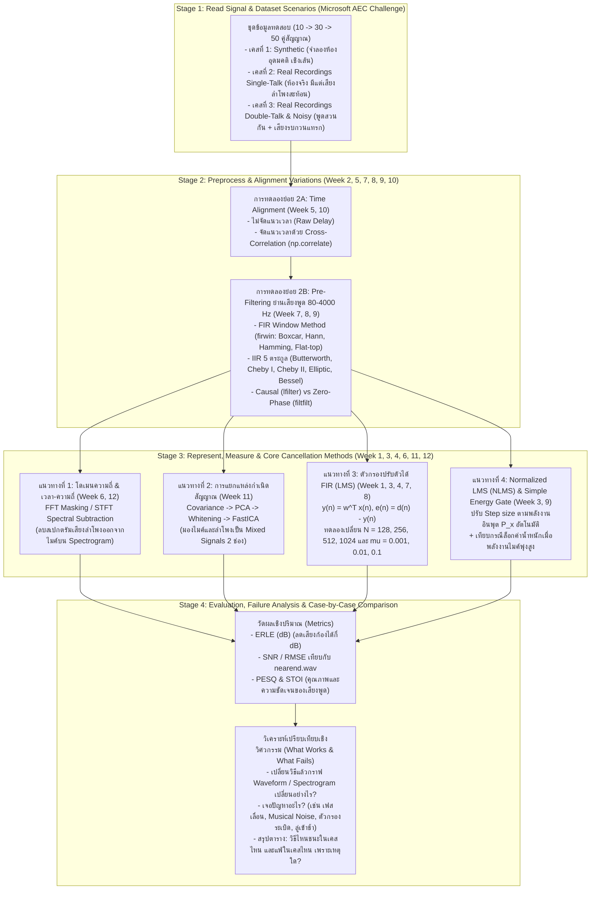
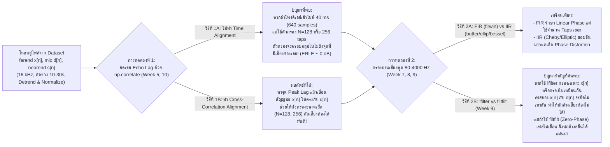
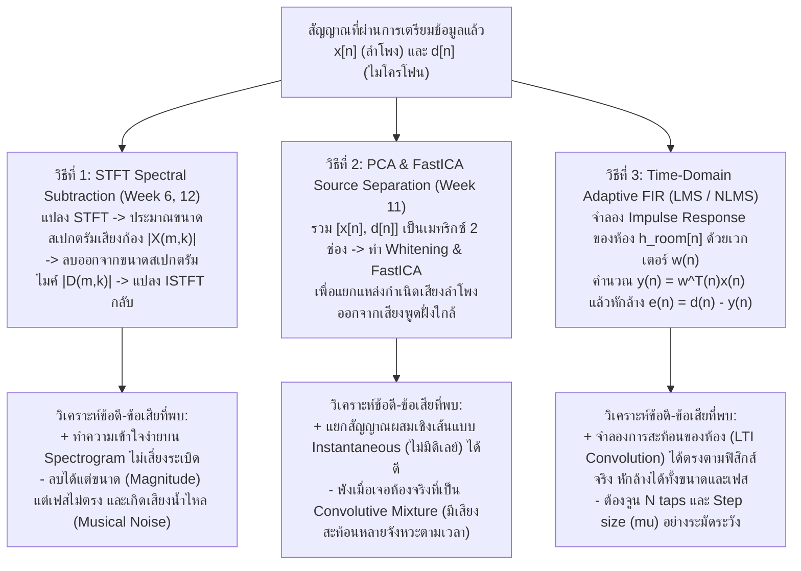
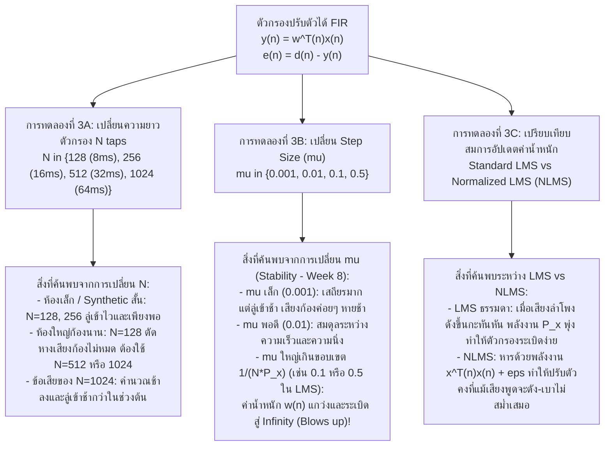
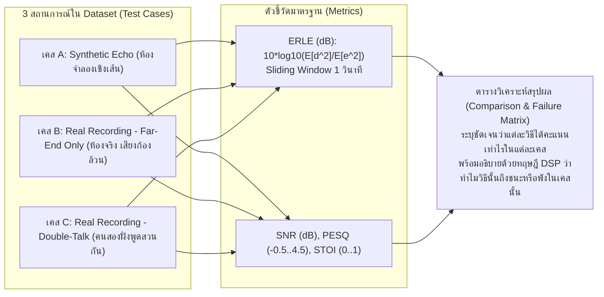

# สถาปัตยกรรมและแผนผังการไหลของข้อมูล (Data Flow Architecture): DSP Final Project

> **ชื่อโครงงาน**: การวิเคราะห์ชุดข้อมูลเสียงสะท้อนและเปรียบเทียบกระบวนการตัดเสียงรบกวนด้วยเทคนิค DSP เชิงทดลอง (Dataset-Driven Acoustic Echo & Noise Analysis: A Comparative & Ablation Study of Classical DSP Techniques)  
> **วิชา**: Digital Signal Processing (DSP) | **อาจารย์ผู้สอน**: อ.ดร.ณัฐพงศ์ จิวมั่งมี  
> **กำหนดส่ง**: วันอังคารที่ 10 พฤศจิกายน 2569  
> **หัวใจหลักของโปรเจกต์ตามแนวทางอาจารย์ผู้สอน (Professor's Core Philosophy)**:  
> 1. **ไม่จำเป็นต้องใช้โมเดล AI/ML (และไม่จำเป็นต้องยึดติดกับ `if-else` ซับซ้อน)**: แก่นแท้ของงานคือการนำ **Dataset จริง (Microsoft AEC Challenge: `real_recordings` vs `synthetic`)** มาทดลองด้วย **เครื่องมือและทฤษฎีที่เรียนในวิชา DSP (Week 1–12)**  
> 2. **เน้นการตั้งคำถามและเปรียบเทียบว่า "ถ้าเปลี่ยนวิธีจะเป็นอย่างไร?" (What-If & Method Comparison)**:  
>    - ถ้าเปลี่ยนชนิดตัวกรอง (FIR vs IIR, 5 ตระกูล IIR, `lfilter` vs `filtfilt`) ผลลัพธ์ต่างกันอย่างไร?  
>    - ถ้าทำ Time Alignment ด้วย Cross-Correlation ก่อนเข้าตัวกรอง เทียบกับไม่ทำ อะไรจะเกิดขึ้น?  
>    - ถ้าเปลี่ยนวิธีการตัดเสียงก้อง/เสียงรบกวน (Frequency-domain Spectral Subtraction บน STFT vs Time-domain LMS vs NLMS vs Source Separation PCA/ICA) และเปลี่ยนพารามิเตอร์ ($N\text{ taps}, \mu$) จะเจอปัญหาอะไร?  
>    - **สรุปให้ชัดว่า**: วิธีไหน **ดีกว่าในเคสไหน** (เช่น ห้องเล็ก, ห้องจำลอง, เสียงนิ่ง) และวิธีไหน **แย่กว่า/พังในเคสไหน** (เช่น ห้องก้องยาว, ห้องอัดจริงที่มีความไม่เป็นเชิงเส้น, ช่วงพูดสวนกัน Double-Talk, หรือตั้ง $\mu$ ใหญ่เกินจนระบบระเบิด)  
>
> **การแบ่งบทบาทเอเจนต์ (Agent Governance)**:  
> - **Antigravity (`AGY`) — ผู้ลงมือพัฒนาหลัก (Primary Implementer)**: เขียนสคริปต์สำรวจ Dataset, สร้างชุดการทดลองเปรียบเทียบแต่ละวิธีตามเนื้อหา Week 1–12, รันวัดผล (ERLE, SNR, PESQ, STOI), บันทึกเคสที่สำเร็จและเคสที่ล้มเหลว, พล็อตกราฟ และเขียนรายงานวิเคราะห์เชิงลึก  
> - **OpenAI Codex (`CDX`) — ผู้ควบคุมและตรวจสอบคุณภาพ (Supervisor, Controller & QA Auditor)**: ตรวจสอบความถูกต้องของสมการและโค้ดทุกการทดลอง, ตรวจสอบว่าการเปรียบเทียบยุติธรรม (Controlled Experiment), ตรวจทานตัวเลขและเหตุผลทางทฤษฎี DSP ว่าทำไมวิธีหนึ่งจึงดีกว่าหรือแย่กว่าอีกวิธีในแต่ละเคส  

---

## ส่วนที่ 1: แผนผังการไหลของข้อมูลระดับภาพรวมทั้งระบบ (1. Overall System Data Flow)

แผนผังภาพรวมแสดงการนำ **Dataset** ไหลผ่าน **4-Stage DSP Pipeline** โดยในแต่ละขั้นจะมีการ **"สลับเปลี่ยนวิธีการที่เรียนมา (Method Variations)"** เพื่อสังเกตปัญหาและเปรียบเทียบว่าวิธีใดเหมาะกับสถานการณ์ใด:



---

## ส่วนที่ 2: แผนผังการไหลของข้อมูลแยกตามส่วนงานและจุดเปรียบเทียบ (2. Component Data Flows & Experimental Comparisons)

### 2.1 ส่วนงานที่ 1: การสำรวจ Dataset และผลกระทบของการจัดแนวเวลา & การกรองเบื้องต้น (Preprocessing & Alignment Experiments)
นำความรู้ **Week 2 (Normalization/Detrend)**, **Week 5 & 10 (Cross-Correlation & Multi-rate)** และ **Week 7, 8, 9 (FIR vs IIR, `lfilter` vs `filtfilt`)** มาทดลองกับ Dataset เพื่อดูว่าถ้าทำหรือไม่ทำแต่ละขั้น จะเกิดปัญหาอะไร:



---

### 2.2 ส่วนงานที่ 2: การเปรียบเทียบวิธีตัดเสียงก้องข้ามโดเมน (Time-Domain vs Frequency-Domain vs Source Separation)
นำความรู้จาก **Week 6 & 12 (FFT / STFT Spectrogram)**, **Week 11 (PCA / FastICA)** และ **Week 1, 3, 4, 7 (FIR Convolution & LMS)** มาประชันกันบนข้อมูลชุดเดียวกัน:



---

### 2.3 ส่วนงานที่ 3: เจาะลึกการปรับตัวกรอง LMS vs NLMS และการเปลี่ยนพารามิเตอร์ ($N, \mu$)
ทดสอบเปลี่ยนค่าพารามิเตอร์ตามแผนใน `Update งาน.txt` เพื่อสังเกตพฤติกรรมความเสถียร (**Week 8 Stability**), ความเร็วในการลู่เข้า, และปัญหาเมื่อคนสองฝั่งพูดพร้อมกัน:



---

### 2.4 ส่วนงานที่ 4: การวัดผลและการจัดทำตารางสรุป "วิธีไหนดีกว่า/แย่กว่าในเคสไหน" (Evaluation & Case Matrix Data Flow)



---

## ส่วนที่ 3: ตารางสรุปสมมติฐานการเปรียบเทียบ (What-If & Case-by-Case Comparison Matrix)

ตารางนี้คือหัวใจที่เราจะนำไปพิสูจน์ด้วยตัวเลขและกราฟจาก Dataset เพื่อส่งอาจารย์:

| การทดลอง / วิธีการที่เปรียบเทียบ | เนื้อหาวิชา DSP ที่ใช้ | ดีกว่าในเคสไหน? (จุดแข็ง) | แย่กว่าหรือเจอปัญหาอะไรในเคสไหน? (จุดอ่อน / ข้อจำกัด) |
| :--- | :---: | :--- | :--- |
| **1. ไม่ทำ vs ทำ Cross-Correlation Alignment (`np.correlate`)** | Week 5, Week 10 | **การทำ Alignment ดีกว่ามากในเคสที่ลำโพงห่างจากไมค์หรือมี Buffer Delay สูง** เพราะช่วยเลื่อนจุดเริ่มต้นเสียงก้องมาอยู่ในระยะของตัวกรองทันที | **ถ้าไม่ทำ Alignment**: ในไฟล์ `real_recordings` ที่มี Acoustic/System Delay เกินความยาว $N$ taps ตัวกรองจะมองไม่เห็นเสียงก้องเลย (ตัดไม่ออก) |
| **2. การกรองความถี่ด้วย `lfilter` vs `filtfilt` (IIR vs FIR)** | Week 7, Week 8, Week 9 | **`filtfilt` (Zero-Phase) และ Linear-Phase FIR ดีกว่าในการเตรียมสัญญาณ Offline** เพราะรักษาเฟสและความสัมพันธ์เชิงเวลาระหว่าง $x[n]$ กับ $d[n]$ ไว้ได้ 100% | **`lfilter` (Non-linear Phase IIR เช่น Elliptic/Cheby)**: หากนำไปกรอง $x[n]$ โดยไม่ระวัง จะทำให้เฟสของความถี่ต่างๆ เลื่อนไม่เท่ากัน ส่งผลให้หักล้างคลื่น ($d[n] - y[n]$) ไม่สนิท |
| **3. STFT Spectral Subtraction (ลบในโดเมนความถี่)** | Week 6, Week 12 | **ดีกว่าในเคสที่มีเสียงรบกวนคงที่ (Stationary Noise / 50 Hz Hum)** หรือเมื่อไม่ทราบเวลา Delay ที่แน่นอน เพราะลบขนาดสเปกตรัมออกโดยตรงและไม่เสี่ยงที่ตัวกรองจะระเบิด | **แย่กว่าในเคสเสียงพูดสะท้อนในห้องจริง**: เพราะการสะท้อนในห้องยาวข้ามหลายเฟรม STFT และลบได้เฉพาะขนาด (Magnitude) ไม่ได้แก้เฟส อีกทั้งทำให้เกิดเสียงเพี้ยนคล้ายน้ำไหล (Musical Noise) |
| **4. PCA / FastICA (Blind Source Separation)** | Week 11 | **ดีกว่าในเคสที่สัญญาณผสมกันแบบทันทีทันใด (Instantaneous Linear Mixture)** โดยไม่มีการหน่วงเวลาหรือการสะท้อนซ้ำ | **แย่กว่าในเคสห้องก้อง (Convolutive Mixture)**: เพราะเสียงในห้องสะท้อนมาหลายระลอก ($x[n-1], x[n-2], \dots$) ทำให้ PCA/ICA แยกเสียงก้องที่มีหางยาวไม่ออก |
| **5. Standard LMS ($N$ เล็ก vs $N$ ใหญ่, $\mu$ เล็ก vs $\mu$ ใหญ่)** | Week 1, Week 3, Week 4, Week 8 | **$N=128, 256$ ดีกว่าในห้องเล็ก (ลู่เข้าไว)** ส่วน **$N=512, 1024$ ดีกว่าในห้องโถงที่เสียงก้องค้างนาน** | **ปัญหาสำคัญของ LMS**: ถ้าตั้ง $\mu$ ใหญ่เกินขอบเขตเสถียรภาพ $\frac{1}{N \cdot P_x}$ หรือเจอจังหวะที่เสียงลำโพงดังพุ่งขึ้นกะทันหัน ตัวกรองจะ **ระเบิด (Diverge / Blows up)** ทันที |
| **6. Normalized LMS (NLMS) vs Standard LMS** | Week 3, Week 7, Week 8 | **NLMS ดีกว่า LMS อย่างชัดเจนในสัญญาณเสียงพูดจริง (`real_recordings`)** เพราะเสียงพูดมีพลังงานขึ้นลงตลอดเวลา NLMS หารด้วยกำลังงาน $\mathbf{x}^T\mathbf{x}$ จึงปรับตัวได้เร็วโดยไม่ระเบิด | **ปัญหาเมื่อเกิด Double-Talk (คนสองฝั่งพูดสวนกัน)**: หากทั้ง LMS และ NLMS ปรับค่าน้ำหนักตลอดเวลาโดยไม่หยุดพัก เสียงพูดของคนฝั่งใกล้ ($s[n]$) จะไปกวนการอัปเดตค่าน้ำหนัก ทำให้เสียงพูดตัวเองแหว่งหรือบิดเบี้ยว (ซึ่งแสดงให้เห็นว่าทำไมระบบระดับ Production อย่าง WebRTC จึงต้องมีกลไกตรวจจับ Double-Talk เพิ่มเติม) |

---

## ส่วนที่ 4: โครงสร้างไฟล์โปรเจกต์ กฎ GitHub และจุดที่ผิดบ่อย (Repo Structure, Git Guardrails & Sanity Checks)

### 4.0 โครงสร้าง Repository และกฎเหล็กห้ามอัปโหลด Dataset ขึ้น GitHub
- **ห้าม Push Dataset ขึ้น GitHub เด็ดขาด**: ชุดข้อมูล Microsoft AEC Challenge มีขนาดหลาย GB และติดเงื่อนไข License การวิจัย ดังนั้นต้องบล็อกผ่านไฟล์ [`.gitignore`](file:///C:/Users/khaok/69-1/DSP/FinalProject/.gitignore) (`data/`, `*.wav`, `*.mp3`, `*.m4a`) และให้เพื่อนในทีมดาวน์โหลดตามคู่มือใน [`README.md`](file:///C:/Users/khaok/69-1/DSP/FinalProject/README.md) หรือแชร์ผ่าน Kaggle Dataset แทน
- **โครงสร้างมาตรฐานของโปรเจกต์ (`DSP/FinalProject/`)**:
  ```text
  FinalProject/
  ├── src/
  │   ├── lms.py               # LMS Adaptive Filter + Delay Estimation (Cross-Correlation)
  │   ├── nlms.py              # NLMS + Comparative DSP Methods (STFT / PCA-ICA / FIR-IIR)
  │   ├── metrics.py           # ERLE (Sliding Window), SNR, PESQ, STOI
  │   └── baseline_webrtc.py   # WebRTC AEC Baseline + Internal Delay Alignment
  ├── notebooks/
  │   └── experiment.ipynb     # สมุดทดลองรันเปรียบเทียบและพล็อตกราฟ
  ├── results/
  │   └── figures/             # กราฟและตารางสรุปผลทั้งหมด
  ├── data/                    # [GIT-IGNORED] โฟลเดอร์เก็บ Dataset (ห้ามขึ้น GitHub)
  ├── .gitignore
  └── README.md
  ```

### 4.1 Phase 0: Mandatory Sanity Check (ต้องรันให้ผ่านก่อนแตะ Dataset จริง!)
- **การทดสอบ Sine-Wave Echo Cancellation**:
  - สร้างสัญญาณทดสอบสังเคราะห์เอง: ให้ `farend` $x[n]$ เป็นคลื่น Sine Wave (เช่น $440\text{ Hz}$) แล้วนำมาบวกเข้ากับสัญญาณไมค์ $d[n]$ โดยตรง (หรือผ่าน FIR ง่ายๆ 3-5 taps ที่ทราบค่าแน่นอน)
  - รันโค้ด LMS / NLMS ของเราเพื่อดูว่าตัวกรองสามารถลู่เข้าและลบคลื่น Sine Wave นั้นออกจนเกือบเป็นศูนย์ ($\text{ERLE} > 30\text{ dB}$) ได้จริงหรือไม่
  - **เกณฑ์ตัดสิน**: หากลบ Sine Wave พื้นฐานไม่ออก แสดงว่าการวาง Buffer $\mathbf{x}[n]$ หรือสมการอัปเดต $\mathbf{w}[n]$ มีบั๊ก ห้ามรันกับ Dataset จริงจนกว่าจะแก้ผ่าน

### 4.2 Phase 1 Pitfalls — Dataset & Preprocessing
1. **Sample Rate ไม่ตรงกัน**:
   - `farend.wav`, `mic.wav`, `nearend.wav` ต้องมี $f_s = 16,000\text{ Hz}$ เท่ากันทุกไฟล์ หากไม่ตรงกัน ตัวกรองจะลู่เข้าผิดทั้งหมด ต้องสั่ง `assert sr_far == sr_mic == sr_near == 16000` เสมอ
2. **Length ไม่เท่ากัน (Sample-by-Sample Mismatch)**:
   - ความยาวของสัญญาณต้องเท่ากันเป๊ะระดับ Sample (`len(farend) == len(mic) == len(nearend)`) หากคลาดเคลื่อนแม้แต่ 1 sample จะเกิดการ Misalign และทำให้ค่า ERLE/PESQ ตกฮวบ

### 4.3 Phase 2 Pitfalls — LMS / NLMS Implementation
1. **Delay ระหว่าง `farend` กับเสียงก้องใน `mic` (จุดที่สำคัญและผิดบ่อยที่สุด!)**:
   - เสียงจากลำโพงต้องเดินทางผ่านอากาศก่อนถึงไมค์ ทำให้เสียงก้องใน `mic` มาช้ากว่า `farend` เสมอ
   - หากไม่ชดเชย Delay นี้ก่อน ตัวกรองที่มีความยาว $N$ จำกัดจะพยายามจับคู่สัญญาณที่ไม่ตรงเวลากันและไม่ลู่เข้าเลย
   - **วิธีแก้บังคับ**: ประมาณค่า Delay Lag ด้วย **Cross-Correlation (`np.correlate`)** ก่อน แล้วทำการ **Shift สัญญาณ `farend`** ให้ตรงกับจุดเริ่มต้นของเสียงก้องใน `mic` ก่อนส่งเข้า LMS/NLMS
2. **การตั้งค่า $\mu$ (Step Size) ใหญ่เกินไป**:
   - หากค่าน้ำหนัก $\mathbf{w}[n]$ เกิดการ Diverge สัญญาณขาออกจะกลายเป็น Noise รุนแรงหรือค่า `NaN` / `Inf` ทันที
   - ต้องเริ่มไล่จาก $\mu$ เล็กๆ ก่อนเสมอ (เช่น $\mu = 0.001$) และใส่การเช็ก `np.isnan` / ขอบเขตเสถียรภาพ $\mu < \frac{1}{N \cdot P_x}$
3. **การจัดการ Buffer $\mathbf{x}(n)$ ผิดพลาด**:
   - LMS ต้องการเวกเตอร์อินพุตย้อนหลัง $N$ จุดในลำดับเวลาที่ถูกต้อง: $\mathbf{x}(n) = [x(n), x(n-1), \dots, x(n-N+1)]^T$
   - ระวังปัญหา Index ชนขอบ การสไลซ์อาเรย์กลับด้าน หรือการเลื่อน Buffer ผิดทิศทางซึ่งจะทำให้การอัปเดตค่าน้ำหนักผิดทั้งหมด

### 4.4 Phase 3 Pitfalls — การวัดผล (Evaluation Metrics)
1. **การวัดค่า ERLE ผิดช่วงเวลา**:
   - สมการ $\text{ERLE} = 10 \log_{10}(E[d^2(n)] / E[e^2(n)])$ จะวัดประสิทธิภาพการตัดเสียงก้องได้ถูกต้อง **เฉพาะในช่วงที่มีแต่เสียงก้อง (Far-end Single-Talk / ช่วงที่ `nearend` เงียบ)** เท่านั้น
   - ถ้านำช่วงที่มีคนฝั่งใกล้พูด (`nearend` มีเสียง) มาคำนวณรวมในสมการ ERLE ตรงๆ ตัวหาร $E[e^2(n)]$ จะมีพลังงานเสียงพูดปนอยู่ ทำให้ค่า ERLE ออกมาต่ำหรือบิดเบือนจากความเป็นจริง จึงต้องคัดเลือกเฉพาะ Segment/เฟรมที่ `nearend` เงียบในการวัด ERLE (หรือหากมี `nearend.wav` สามารถวัด Echo Attenuation เทียบกับส่วนประกอบเสียงก้องจริงได้)
2. **การใส่ตัวแปร Reference ใน PESQ / STOI ผิดตัว**:
   - ทั้ง `pesq(16000, ref, deg, 'wb')` และ `stoi(ref, deg, 16000)` ต้องใช้ **`nearend.wav` (เสียงพูดสะอาด) เป็น `ref`** เทียบกับ **`e(n)` (สัญญาณขาออกจากตัวกรอง) เป็น `deg`** (สำหรับเคสที่มีเสียงพูด nearend) ห้ามใส่สลับตำแหน่งหรือเทียบผิดคู่โดยเด็ดขาด

### 4.5 Phase 4 Pitfalls — การเปรียบเทียบกับ Baseline (WebRTC AEC)
1. **Internal Delay ของ WebRTC AEC**:
   - โมดูล WebRTC AEC จะมีการหน่วงเวลาภายใน (Internal Pipeline Delay) อัตโนมัติ ทำให้สัญญาณขาออกของ WebRTC เลื่อนเวลาไปจาก `nearend.wav` ต้นฉบับ
   - **วิธีแก้บังคับ**: ก่อนนำเอาต์พุตของ WebRTC AEC ไปคำนวณค่า ERLE / PESQ / STOI ต้องทำ Time Alignment (ด้วย Cross-Correlation เทียบกับ `nearend.wav` หรือ `mic.wav`) เพื่อชดเชย Internal Delay ก่อนเสมอ มิฉะนั้นคะแนนของ WebRTC จะออกมาต่ำกว่าความเป็นจริง

