# 📘 รายงานโครงงานฉบับสมบูรณ์ (DSP Final Project Report)

**รหัสวิชา:** 517354 Digital Signal Processing (การประมวลผลสัญญาณดิจิทัล)  
**ภาคการศึกษา:** ภาคการศึกษาปลาย ปีการศึกษา 2569  
**อาจารย์ผู้สอน:** อ.ดร.ณัฐพงศ์ จิวมั่งมี  
**ภาควิชาคอมพิวเตอร์ คณะวิทยาศาสตร์ มหาวิทยาลัยศิลปากร**

---

# ชื่อโครงงาน: การวิเคราะห์และเปรียบเทียบประสิทธิภาพการตัดเสียงสะท้อนอะคูสติกด้วยตัวกรองปรับตัวได้ (Acoustic Echo Cancellation: LMS vs NLMS with Delay Compensation)

> **ผู้จัดทำโครงงาน (Project Team):**
> 1. [ชื่อ-นามสกุล นักศึกษา 1] รหัสนักศึกษา: [xxxxxxxx]
> 2. [ชื่อ-นามสกุล นักศึกษา 2] รหัสนักศึกษา: [xxxxxxxx]
> 3. [ชื่อ-นามสกุล นักศึกษา 3] รหัสนักศึกษา: [xxxxxxxx]
>
> **วันที่ส่งรายงาน:** 8 พฤศจิกายน 2569  
> **Repository โค้ดและการทดลอง:** `C:\Users\khaok\69-1\DSP\FinalProject`

---

## 📑 สารบัญ (Table of Contents)
1. [บทคัดย่อ (Abstract)](#1-บทคัดย่อ-abstract)
2. [บทนำและที่มาของปัญหา (Introduction & Problem Statement)](#2-บทนำและที่มาของปัญหา-introduction--problem-statement)
3. [การสำรวจและทำความเข้าใจชุดข้อมูล (Exploratory Data Analysis: EDA)](#3-การสำรวจและทำความเข้าใจชุดข้อมูล-exploratory-data-analysis-eda)
4. [ข้อจำกัดของตัวกรองเชิงเส้นแบบดั้งเดิม (Failure Analysis of Classical LTI Filters)](#4-ข้อจำกัดของตัวกรองเชิงเส้นแบบดั้งเดิม-failure-analysis-of-classical-lti-filters)
5. [การตรวจจับความหน่วงเวลาเสียงสะท้อน (Echo Lag Detection with Cross-Correlation)](#5-การตรวจจับความหน่วงเวลาเสียงสะท้อน-echo-lag-detection-with-cross-correlation)
6. [สถาปัตยกรรมระบบและพิมพ์เขียว DSP Pipeline (System Architecture & DSP Pipeline)](#6-สถาปัตยกรรมระบบและพิมพ์เขียว-dsp-pipeline-system-architecture--dsp-pipeline)
7. [ทฤษฎีตัวกรองปรับตัวได้และการสร้างโมเดล (Adaptive Filter Theory & Formulation)](#7-ทฤษฎีตัวกรองปรับตัวได้และการสร้างโมเดล-adaptive-filter-theory--formulation)
8. [ชุดการทดลอง 4 เสาหลัก (The 4 Pillars Benchmark Suite)](#8-ชุดการทดลอง-4-เสาหลัก-the-4-pillars-benchmark-suite)
9. [ผลการทดลองและการวิเคราะห์ผลลัพธ์ 3 สถานการณ์ (Experimental Results & Discussion)](#9-ผลการทดลองและการวิเคราะห์ผลลัพธ์-3-สถานการณ์-experimental-results--discussion)
10. [การเปรียบเทียบความถูกต้องกับมาตรฐานสากล (Validation with World-Standard Library)](#10-การเปรียบเทียบความถูกต้องกับมาตรฐานสากล-validation-with-world-standard-library)
11. [สรุปผลการวิจัยและข้อเสนอแนะ (Conclusion & Future Work)](#11-สรุปผลการวิจัยและข้อเสนอแนะ-conclusion--future-work)
12. [เอกสารอ้างอิง (References)](#12-เอกสารอ้างอิง-references)
13. [ภาคผนวก (Appendix): โครงสร้างซอร์สโค้ดและการทำซ้ำผลลัพธ์](#13-ภาคผนวก-appendix-โครงสร้างซอร์สโค้ดและการทำซ้ำผลลัพธ์)

---

## 1. บทคัดย่อ (Abstract)

โครงงานนี้นำเสนอการศึกษา วิจัย และพัฒนาแบบจำลองการตัดเสียงสะท้อนในห้อง (Acoustic Echo Cancellation: AEC) สำหรับระบบการสื่อสารเสียงแบบเรียลไทม์ โดยมุ่งเน้นการเปรียบเทียบประสิทธิภาพระหว่างอัลกอริทึมตัวกรองปรับตัวได้ **Least Mean Squares (LMS)** และ **Normalized Least Mean Squares (NLMS)** ซึ่งพัฒนาขึ้นด้วย Pure NumPy จากพื้นฐานทางคณิตศาสตร์โดยตรง 

ในการศึกษานี้ ได้ทำการวิเคราะห์เชิงลึกเพื่อพิสูจน์ทางวิทยาศาสตร์ว่าเหตุใดตัวกรองเชิงเส้นไม่แปรเปลี่ยนตามเวลาแบบดั้งเดิม (Classical LTI Filters) และเทคนิคที่ได้ศึกษาในห้องปฏิบัติการ (Butterworth Filter, Inverse Filtering, FastICA และ STFT Spectral Subtraction) จึงไม่สามารถแก้ปัญหาเสียงสะท้อนในห้องได้เนื่องจากปัญหาการทับซ้อนของแถบความถี่ (Spectral Overlap) และลักษณะการสะท้อนแบบก้องในมิติเวลา (Convolutive Reverberation)

เพื่อแก้ไขปัญหาดังกล่าว คณะผู้จัดทำได้เสนอสถาปัตยกรรม **DSP Pipeline** ที่ประกอบด้วยการค้นหาความหน่วงเวลาการเดินทางของเสียง (Time-of-Flight / Bulk Delay) ด้วยเทคนิค **Cross-Correlation** ร่วมกับการชดเชยดีเลย์ (Delay Compensation) ก่อนส่งสัญญาณเข้าสู่ตัวกรองปรับตัวได้ จากการทดลองใน 3 สถานการณ์จำลองจริง ได้แก่:
1. **สถานการณ์ S1 (คนพูด 1 คน ในห้องและตำแหน่งคงที่):** ระบบ NLMS ร่วมกับ Delay Compensation สามารถลดทอนเสียงสะท้อนได้สูงถึง **69.32 dB** (ประเมินด้วยค่า Echo Return Loss Enhancement: ERLE) เทียบกับ Standard LMS ที่ทำได้เพียง **9.05 dB**
2. **สถานการณ์ S2 (คนพูด 2 คน ในสภาวะ Double-talk):** ตัวกรองสามารถตัดเสียงสะท้อนจากลำโพงออกได้อย่างหมดจดโดยยังคงรักษารูปคลื่นและเนื้อเสียงของคนพูดหน้าไมโครโฟน (Near-End Speech) ไว้ได้อย่างสมบูรณ์
3. **สถานการณ์ S3 (คนพูดเคลื่อนที่เปลี่ยนตำแหน่งในห้อง):** ตัวกรอง NLMS สามารถปรับค่าน้ำหนักลู่เข้าสู่สมดุลใหม่ (Re-convergence) ได้อย่างรวดเร็วหลังการเปลี่ยนสภาพแวดล้อมทางอะคูสติก

นอกจากนี้ ผลลัพธ์ของโมเดล NLMS ที่พัฒนาขึ้นเองยังได้รับการพิสูจน์ความถูกต้องเทียบเท่ากับไลบรารีมาตรฐานสากล (`padasip`) โดยมีค่าสัมประสิทธิ์สหสัมพันธ์ (Correlation Coefficient) สูงถึง **100.000000%** และมีความคลาดเคลื่อนสัมบูรณ์เฉลี่ยเพียง **$1.36 \times 10^{-18}$**

**คำสำคัญ:** Digital Signal Processing, Acoustic Echo Cancellation (AEC), Adaptive Filters, LMS, NLMS, Cross-Correlation, Delay Compensation, Spectral Overlap, ERLE

---

## 2. บทนำและที่มาของปัญหา (Introduction & Problem Statement)

### 2.1 ที่มาของปัญหาในชีวิตจริง
ในยุคปัจจุบันที่การติดต่อสื่อสารและการทำงานร่วมกันผ่านระบบออนไลน์ (เช่น Zoom, Discord, Google Meet, Microsoft Teams) กลายเป็นส่วนหนึ่งในชีวิตประจำวัน ปัญหาที่พบบ่อยและสร้างความรำคาญใจอย่างยิ่งต่อผู้ใช้งานคือ **"การได้ยินเสียงสะท้อนของตนเอง" (Acoustic Echo)**

ในความเป็นจริงของระบบอะคูสติกส์ ปัญหาเสียงสะท้อนนี้ไม่ได้เกิดขึ้นที่เครื่องต้นทางของผู้พูด แต่เกิดขึ้นที่ **"เครื่องปลายทางของคู่สนทนาที่เปิดลำโพงทิ้งไว้โดยไม่สวมหูฟัง"**:
1. ผู้พูด $A$ ส่งเสียงผ่านไมโครโฟน วิ่งผ่านเครือข่ายอินเทอร์เน็ตไปยังเครื่องของคู่สนทนา $B$
2. สัญญาณเสียงดังกล่าวถูกขับออกจากลำโพง (Loudspeaker) ของคู่สนทนา $B$ เรียกว่าสัญญาณ **Far-End Signal ($x[n]$)**
3. คลื่นเสียงเดินทางผ่านอากาศ เกิดการตกกระทบและสะท้อนกับกำแพง เพดาน โต๊ะ และสิ่งกีดขวางภายในห้อง เรียกว่า **Room Impulse Response ($h[n]$)**
4. คลื่นเสียงที่สะท้อนวนเวียนภายในห้องจะเล็ดลอดเข้าสู่ไมโครโฟนของคู่สนทนา $B$ กลายเป็นสัญญาณเสียงสะท้อน **Echo ($d[n] = x[n] * h[n]$)**
5. ไมโครโฟนของ $B$ จะส่งสัญญาณเสียงก้องนี้ย้อนกลับผ่านเครือข่ายอินเทอร์เน็ตกลับมายังหูของผู้พูด $A$

```
[ผู้พูด A (Far-End)] ----(ส่งเสียงผ่านเน็ต)----> [ลำโพงของ B]
        ^                                            |
        |                                       (สะท้อนในห้อง h[n])
        |                                            v
(ได้ยินเสียงสะท้อนตัวเอง) <---(ส่งย้อนกลับ)-- [ไมค์ของ B] <--- [เสียงพูดของ B (Near-End)]
```

### 2.2 ผลกระทบทางจิตวิทยาและประสาทการรับฟัง (Delayed Auditory Feedback: DAF)
ในทางวิทยาศาสตร์การได้ยิน (Psychoacoustics) เมื่อมนุษย์เปล่งเสียงพูดแล้วได้ยินเสียงตนเองสะท้อนย้อนกลับเข้ามาในหูโดยมีความหน่วงเวลาประมาณ **$50 - 200\text{ ms}$** จะเกิดปรากฏการณ์ที่เรียกว่า **Delayed Auditory Feedback (DAF)** ปรากฏการณ์นี้รบกวนวงจรควบคุมการพูดของสมองโดยอัตโนมัติ ส่งผลให้ผู้พูดเกิดอาการลิ้นพันกัน ชะงัก สะดุด และไม่สามารถพูดต่อเนื่องได้

ด้วยเหตุนี้ ระบบ **Acoustic Echo Cancellation (AEC)** จึงเป็นโมดูลประมวลผลสัญญาณดิจิทัลที่สำคัญยิ่งในอุปกรณ์สื่อสารทุกชนิด หากปราศจากระบบ AEC การสนทนาแบบแฮนด์ฟรีหรือการเปิดลำโพงคุยกันย่อมไม่สามารถทำงานได้อย่างมีประสิทธิภาพ

---

## 3. การสำรวจและทำความเข้าใจชุดข้อมูล (Exploratory Data Analysis: EDA)

ในการออกแบบระบบประมวลผลสัญญาณดิจิทัลที่มีประสิทธิภาพ จำเป็นต้องทำความเข้าใจธรรมชาติของสัญญาณเสียงพูดและสิ่งแวดล้อมอะคูสติกส์อย่างถ่องแท้

### 3.1 คุณลักษณะของสัญญาณเสียงพูดมนุษย์ (Speech Signal Properties)
* **Sampling Rate ($f_s$):** ข้อมูลสัญญาณเสียงทั้งหมดในโปรเจกต์ถูกสุ่มสัญญาณที่ความถี่ $f_s = 16,000\text{ Hz}$ (ความกว้างแถบความถี่ Nyquist สูงสุดอยู่ที่ $8,000\text{ Hz}$) ซึ่งครอบคลุมย่านความถี่เสียงพูดของมนุษย์ได้อย่างสมบูรณ์ตามมาตรฐานระบบโทรคมนาคม (Wideband Audio)
* **ฮาร์มอนิกและสเปกตรัมเรโซแนนซ์ (Formants):** เสียงพูดมนุษย์ประกอบด้วยความถี่มูลฐาน (Fundamental Frequency: $F_0$) ในช่วง $85 - 255\text{ Hz}$ และแถบพลังงานความถี่เด่นที่เกิดจากการก้องในช่องคอและโพรงปาก เรียกว่า **Formants** ($F_1, F_2, F_3$) ซึ่งแผ่กว้างอยู่ในย่าน $300\text{ Hz} - 3,500\text{ Hz}$

```
พลังงานเสียง
  ^          F1 (~500Hz)       F2 (~1500Hz)
  |             /\                 /\
  |            /  \               /  \            F3 (~2500Hz)
  |   F0      /    \             /    \               /\
  |  /\      /      \           /      \             /  \
  +-/--\----/--------\---------/--------\-----------/----\-----> ความถี่ (Hz)
   100-250    300-800          1200-2000         2200-3000
```

### 3.2 ปรากฏการณ์ความละเอียดแกนความถี่และ Spectral Leakage
ในการแปลงสัญญาณเข้าสู่โดเมนความถี่ด้วย Fast Fourier Transform (FFT) การกำหนดขนาด $N$ มีผลโดยตรงต่อความละเอียดทางความถี่ (Frequency Resolution: $\Delta f$):
$$\Delta f = \frac{f_s}{N}$$
จากการทดลองสำรวจใน `main.ipynb`:
* เมื่อสุ่มสัญญาณช่วงเวลาสั้น $0.1\text{ วินาที}$ ($N = 1,600$ จุด) จะได้ $\Delta f = \frac{16000}{1600} = 10\text{ Hz}$
* หากสัญญาณมีองค์ประกอบความถี่ $325\text{ Hz}$ ซึ่งตกอยู่กึ่งกลางระหว่างช่องความถี่ (Bin) $320\text{ Hz}$ และ $330\text{ Hz}$ พอดี พลังงานจะเกิดการรั่วไหลออกสู่ช่องด้านข้าง เรียกว่า **Spectral Leakage**
* การบรรเทาปัญหานี้ทำได้โดยการใช้ฟังก์ชันหน้าต่าง (Windowing เช่น Hann Window) ร่วมกับการเติมศูนย์ (Zero-Padding) เพื่อเพิ่มความละเอียดในการอ่านยอดสเปกตรัม

### 3.3 แบบจำลองผลตอบสนองอิมพัลส์ของห้อง (Room Impulse Response: RIR)
การสะท้อนของคลื่นเสียงในห้องถูกจำลองด้วยระบบเชิงเส้นไม่แปรเปลี่ยนตามเวลา (Linear Time-Invariant: LTI System) ที่มีผลตอบสนองอิมพัลส์ $h[n]$:
$$d[n] = x[n] * h[n] = \sum_{k=0}^{L-1} h[k] \, x[n-k]$$
โดย $h[n]$ ประกอบด้วย 3 องค์ประกอบหลัก:
1. **Direct Path (เสียงตรง):** อิมพัลส์แรกสุดที่เดินทางเป็นเส้นตรงจากลำโพงสู่ไมโครโฟน
2. **Early Reflections (เสียงสะท้อนระลอกแรก):** เสียงที่ตกกระทบกำแพงหรือโต๊ะ 1-2 ครั้ง มีความหน่วงเวลาต่ำกว่า $50\text{ ms}$
3. **Late Reverberation (หางเสียงก้อง):** การสะท้อนซ้ำไปซ้ำมานับพันครั้งจนกลายเป็นพลังงานที่ค่อยๆ สลายตัวแบบเอ็กซ์โพเนนเชียล ($e^{-\alpha n}$)

ในโครงงานนี้ ได้สร้าง RIR ขึ้นมา 3 ระดับความรุนแรง (`low`, `default/medium`, `high`) โดยกำหนดความยาว $L = 512$ จุด เพื่อจำลองขนาดและวัสดุของห้องที่แตกต่างกัน

---

## 4. ข้อจำกัดของตัวกรองเชิงเส้นแบบดั้งเดิม (Failure Analysis of Classical LTI Filters)

คำถามสำคัญทางวิชาการ: *"ทำไมเราจึงไม่สามารถใช้ตัวกรองแบบดั้งเดิม เช่น Lowpass หรือ Bandstop Filter กรองเสียงสะท้อนออกไปได้?"*

คณะผู้จัดทำได้ทำการทดลองเปรียบเทียบใน Notebook เพื่อพิสูจน์ข้อจำกัดนี้ในเชิงประจักษ์:

### 4.1 ปัญหาการทับซ้อนของแถบความถี่ (Spectral Overlap)
ทั้งเสียงพูดต้นฉบับของผู้พูด Far-End ($x[n]$), เสียงสะท้อนในห้อง ($d[n]$), และเสียงพูดของผู้พูดหน้าไมค์ Near-End ($v[n]$) **ต่างก็เป็นเสียงมนุษย์เหมือนกัน**
* พลังงานส่วนใหญ่ของสัญญาณทั้งสองชุดซ้อนทับกันสนิทในช่วง $100\text{ Hz} - 4,000\text{ Hz}$
* เมื่อตรวจสอบผ่าน Fast Fourier Transform (FFT) พบว่าเส้นสเปกตรัมของทั้งสองสัญญาณทับซ้อนกัน 100%

### 4.2 ผลการทดสอบตัวกรอง LTI ในแล็บ
1. **Lowpass Filter (Butterworth Order 4, $f_c = 300\text{ Hz}$ หรือ $500\text{ Hz}$):**
   - **ผลลัพธ์:** เสียงสะท้อนย่านสูงหายไปบางส่วน แต่พลังงานเสียงสะท้อนย่านต่ำยังคงอยู่ครบถ้วน ขณะที่เนื้อเสียงพูดจริงจะสูญเสียย่านความถี่สูง ทำให้เสียงกลายเป็น **"เสียงอู้อี้เหมือนคุยในโอ่ง"**
2. **Bandstop / Notch Filter (Butterworth ตัดย่าน $200 - 1,000\text{ Hz}$):**
   - **ผลลัพธ์:** เกิดความบิดเบี้ยวของรูปคลื่นเสียง (Waveform Distortion) อย่างรุนแรง เนื้อเสียงแหว่งเว้า แต่เสียงก้องในย่านความถี่อื่นยังคงสะท้อนรบกวนอยู่เช่นเดิม
3. **บทสรุปเชิงทฤษฎี:**
   > *"ตัวกรองคงที่แบบเลือกความถี่ (Fixed Frequency-Selective Filters) ไม่สามารถแยกสัญญาณสองสัญญาณที่แชร์ย่านความถี่เดียวกันออกจากกันได้"*

นี่คือหลักฐานเชิงประจักษ์ 100% ที่ยืนยันว่า **การกำจัดเสียงสะท้อนจำเป็นต้องใช้ตัวกรองปรับตัวได้ (Adaptive Filter)** ที่อาศัยสหสัมพันธ์ของสัญญาณอ้างอิงแทนการตัดความถี่!

---

## 5. การตรวจจับความหน่วงเวลาเสียงสะท้อน (Echo Lag Detection with Cross-Correlation)

### 5.1 ปัญหา Time-of-Flight และ Bulk Delay
ในสภาพแวดล้อมจริง ลำโพงและไมโครโฟนจะตั้งอยู่ห่างกันเป็นระยะทาง $D$ เมตร คลื่นเสียงมีความเร็วในอากาศ $c \approx 343\text{ m/s}$ ส่งผลให้เกิดความหน่วงเวลาเริ่มต้น (Propagation Delay หรือ Bulk Delay):
$$\tau_{\text{prop}} = \frac{D}{c} \quad (\text{วินาที})$$
เมื่อคิดเป็นจำนวนตัวอย่าง (Samples) ที่ความถี่สุ่ม $f_s$:
$$\text{Lag}_{\text{samples}} = \tau_{\text{prop}} \times f_s$$
หากระยะห่างระหว่างลำโพงกับไมค์อยู่ที่ $1.5\text{ เมตร}$ ความหน่วงเวลาจะอยู่ที่ประมาณ $4.37\text{ ms}$ หรือคิดเป็น $70\text{ samples}$ 

> **วิกฤตของตัวกรองปรับตัวได้หากไม่มีการชดเชยดีเลย์:**  
> หากตัวกรองมีขนาด $M = 128$ จุด แต่เสียงสะท้อนเดินทางมาช้า 70 จุด ค่าน้ำหนัก $w[0]$ ถึง $w[69]$ จะต้องเป็นศูนย์เพื่อรอรับสัญญาณ ทำให้เหลือค่าน้ำหนักเพียง 58 จุดในการจำลองหางเสียงสะท้อนของห้อง ซึ่งไม่เพียงพอ ส่งผลให้ตัวกรองไม่สามารถลู่เข้าได้สมบูรณ์

### 5.2 การหาค่า Lag อัตโนมัติด้วย Cross-Correlation
คณะผู้จัดทำได้นำทฤษฎีสหสัมพันธ์ไขว้ (Cross-Correlation) จากเนื้อหาการเรียนมาประยุกต์สร้างฟังก์ชัน `detect_echo_lag()`:
$$r_{d x}[k] = \sum_{n} d[n] \, x[n-k]$$
โดยทำการค้นหาตำแหน่ง Lag $k^*$ ที่ให้ค่าสหสัมพันธ์สูงสุด:
$$k^* = \arg\max_{k \ge 0} |r_{d x}[k]|$$

```
ความแรง Correlation
  ^
1.0 |                Peak ที่เกิดเสียงสะท้อน (k* = 122 samples / 7.64 ms)
    |                     *
    |                    / \
    |                   /   \
0.0 +------+-----------/-----\-------------------> Lag (k samples)
    0      20         122    200
```

จากการทดสอบในสัญญาณจำลอง S1 ระบบสามารถตรวจจับค่าความหน่วงเวลาได้อย่างแม่นยำที่ **$\text{Lag} = 122\text{ samples}$ ($7.64\text{ ms}$)** จากนั้นระบบจะนำค่านี้ไปเลื่อนบัฟเฟอร์สัญญาณอ้างอิง (Delay Compensation) เพื่อให้ตัวกรองปรับตัวได้ทำงานกับจุดเริ่มต้นของเสียงสะท้อนได้ทันที

---

## 6. สถาปัตยกรรมระบบและพิมพ์เขียว DSP Pipeline (System Architecture & DSP Pipeline)

สถาปัตยกรรมของโปรเจกต์ได้รับการออกแบบตาม **DSP Pipeline Blueprint 5 สเตจ** ที่ได้รับคำแนะนำจากอาจารย์ผู้สอนในชั้นเรียน:

```mermaid
flowchart LR
    subgraph S1["1. Signal Ingestion"]
        A["Far-End Voice x[n]"] --> B["Mic Signal d[n]"]
        B --> C["Sampling 16kHz & Normalize"]
    end
    
    subgraph S2["2. Lag Detection"]
        C --> D["Cross-Correlation r_dx"]
        D --> E["Detect Bulk Delay (k*)"]
    end

    subgraph S3["3. Delay Compensation"]
        E --> F["Aligned Reference x[n - k*]"]
    end

    subgraph S4["4. Adaptive Engine"]
        F --> G["NLMS Filter (Order M=128)"]
        G --> H["Estimated Echo y[n]"]
        H --> I["Error Subtraction e[n] = d[n] - y[n]"]
        I -.->|"Weight Update w[n+1]"| G
    end

    subgraph S5["5. Evaluation & Output"]
        I --> J["ERLE Calculation"]
        J --> K["Clean Near-End Output"]
    end
```



### รายละเอียดการทำงานของแต่ละสเตจ:
1. **Stage 1 (Signal Ingestion & Normalization):** รับสัญญาณเสียง Far-End $x[n]$ และสัญญาณไมโครโฟน $d[n]$ ปรับความถี่สุ่มสัญญาณให้เท่ากันที่ $16,000\text{ Hz}$ และตรวจสอบระดับความแรง
2. **Stage 2 (Bulk Delay Detection):** นำสัญญาณความยาว 1 วินาทีแรกมาคำนวณ Cross-Correlation เพื่อหาตำแหน่งเวลาตกกระทบระลอกแรก ($k^*$)
3. **Stage 3 (Delay Compensation Buffer):** ทำการหน่วงเวลาสัญญาณอ้างอิง $x[n]$ ล่วงหน้าเป็นจำนวน $k^*$ จุด เพื่อให้เวกเตอร์อินพุตตรงกับตำแหน่งที่เสียงเริ่มเข้าไมโครโฟน
4. **Stage 4 (Adaptive Filter Engine):** ประมวลผลคำนวณการประมาณค่าเสียงสะท้อน $y[n] = \mathbf{w}^T[n] \mathbf{x}[n]$ และหักล้างออกจากสัญญาณไมโครโฟน $e[n] = d[n] - y[n]$ จากนั้นปรับปรุงค่าน้ำหนักตัวกรอง
5. **Stage 5 (Evaluation & Metrics):** ประเมินประสิทธิภาพการลดทอนเสียงสะท้อนแบบต่อเนื่องด้วยค่า ERLE และ RMSE

---

## 7. ทฤษฎีตัวกรองปรับตัวได้และการสร้างโมเดล (Adaptive Filter Theory & Formulation)

คณะผู้จัดทำได้เขียนอัลกอริทึมตัวกรองปรับตัวได้ขึ้นมาด้วย **Pure NumPy** โดยแบ่งออกเป็น 2 อัลกอริทึมหลัก:

### 7.1 Standard Least Mean Squares (LMS)
LMS เป็นอัลกอริทึมการค้นหาตามความชันที่ลดลง (Stochastic Gradient Descent) เพื่อลดทอนค่าความผิดพลาดกำลังสองเฉลี่ย $J(n) = E[e^2[n]]$:
1. สัญญาณเอาต์พุตจากการประมาณค่าเสียงสะท้อน:
   $$y[n] = \sum_{k=0}^{M-1} w_k[n] \, x[n-k] = \mathbf{w}^T[n] \mathbf{x}[n]$$
2. สัญญาณความผิดพลาด (Error Signal / เอาต์พุตเสียงที่กรองแล้ว):
   $$e[n] = d[n] - y[n]$$
3. กฎการปรับปรุงค่าน้ำหนัก (Weight Update Equation):
   $$\mathbf{w}[n+1] = \mathbf{w}[n] + \mu \, e[n] \, \mathbf{x}[n]$$

> **จุดอ่อนของ Standard LMS:**  
> ค่าอัตราการเรียนรู้ ($\mu$) เป็นค่าคงที่ หากผู้พูดเปล่งเสียงดังขึ้นกะทันหัน เวกเตอร์อินพุต $\|\mathbf{x}[n]\|^2$ จะมีขนาดใหญ่มาก ส่งผลให้ขนาดการปรับปรุงก้าวกระโดดจนตัวกรองหลุดลอย (Diverge) และหากตั้ง $\mu$ เล็กเกินไป ตัวกรองจะลู่เข้าช้ามากจนตามการสะท้อนของห้องไม่ทัน

### 7.2 Normalized Least Mean Squares (NLMS) — พระเอกของโครงงาน
เพื่อแก้ปัญหาความไม่เสถียรของ Standard LMS อัลกอริทึม NLMS จึงทำการปรับสเกลอัตราการเรียนรู้แบบไดนามิกตามพลังงานรวมของสัญญาณอินพุตที่อยู่ในแท็ปตัวกรอง ณ ขณะนั้น:
$$\mathbf{w}[n+1] = \mathbf{w}[n] + \frac{\mu}{\|\mathbf{x}[n]\|^2 + \epsilon} \, e[n] \, \mathbf{x}[n]$$
โดยที่:
* $\mu$ คือ Normalized Step Size (เลือกใช้ช่วง $0.1 - 0.5$)
* $\|\mathbf{x}[n]\|^2 = \sum_{k=0}^{M-1} x^2[n-k]$ คือพลังงานรวมของเวกเตอร์สัญญาณอินพุต
* $\epsilon$ คือค่าคงที่ขนาดเล็ก (เช่น $10^{-6}$) เพื่อป้องกันปัญหาการหารด้วยศูนย์ในช่วงที่ผู้พูดหยุดพูด (Silence)

**ข้อได้เปรียบของ NLMS:** มีความเสถียรภาพสูงมาก ไม่เกิดการระเบิดของตัวกรองเมื่อเจอเสียงพูดที่เบา-ดังสลับกัน และมีความเร็วในการลู่เข้า (Convergence Speed) สูงกว่า LMS ทั่วไปอย่างมีนัยสำคัญ

### 7.3 เกณฑ์การประเมินประสิทธิภาพ: ERLE (Echo Return Loss Enhancement)
ในการวัดความสามารถในการตัดเสียงสะท้อนของตัวกรอง มาตรฐานสากลใช้อัตราส่วนกำลังของสัญญาณก่อนกรองเทียบกับหลังกรอง ในหน่วยเดซิเบล:
$$\text{ERLE} = 10 \log_{10} \left( \frac{E[d^2[n]]}{E[e^2[n]]} \right) \quad (\text{dB})$$
* **ความหมาย:** ค่ายิ่งสูง แสดงว่าตัวกรองสามารถตัดทอนพลังงานของเสียงสะท้อนลงได้มาก โดยค่า ERLE เกิน $20\text{ dB}$ ถือว่าอยู่ในเกณฑ์ที่ดีมากสำหรับงานอะคูสติกส์

---

## 8. ชุดการทดลอง 4 เสาหลัก (The 4 Pillars Benchmark Suite)

เพื่อพิสูจน์ความเหนือกว่าของแบบจำลองที่พัฒนาขึ้น คณะผู้จัดทำได้ออกแบบชุดการทดลองเปรียบเทียบครบ **4 เสาหลัก (4 Pillars)**:

| เสาหลักที่ | ชื่อวิธี / อัลกอริทึม | ที่มา / พื้นฐานคณิตศาสตร์ | ผลการทดสอบเชิงประจักษ์ |
| :---: | :--- | :--- | :--- |
| **Pillar 1** | **Standard LMS** *(เขียนเอง)* | $w + \mu e x$ | ลดทอนเสียงได้ระดับหนึ่ง ($9.05\text{ dB}$) แต่เสี่ยงหลุดลอยเมื่อเสียงดัง |
| **Pillar 2** | **Normalized LMS (NLMS)** *(เขียนเอง)* | $w + \frac{\mu}{\|x\|^2 + \epsilon} e x$ | **ยอดเยี่ยมที่สุด!** ($69.32\text{ dB}$) ลู่เข้าไว นิ่ง และเสถียรสมบูรณ์ |
| **Pillar 3.1** | **Butterworth Filter** *(Lab W7, W9)* | Classical Frequency Cut | **สอบตก!** เจอปัญหา Spectral Overlap เสียงพูดกลายเป็นเสียงอู้อี้ในโอ่ง |
| **Pillar 3.2** | **Inverse Filtering** *(Lab W4, W8)* | Deconvolution $H^{-1}(z)$ | **สอบตก!** ตัวกรองระเบิด (Unstable) เพราะ Zero ของห้องกลายเป็น Pole หลุดนอก Unit Circle |
| **Pillar 3.3** | **FastICA** *(Lab W11)* | Blind Source Separation | **สอบตก!** แยกไม่ออก เพราะ ICA รองรับเฉพาะ Instantaneous Mixture แต่ห้องจริงเป็น Convolutive |
| **Pillar 3.4** | **STFT Spectral Subtraction** *(Lab W12)* | Time-Frequency Subtraction | **มีข้อจำกัด!** ตัดเสียงได้บางส่วน แต่เกิดปรากฏการณ์ **Musical Noise** (เสียงจ๊อกๆ ใต้น้ำ) |
| **Pillar 4** | **Library Benchmark (`padasip`)** | ไลบรารีมาตรฐานสากล | ผลลัพธ์ของโมเดลที่เขียนเองตรงกับไลบรารีสากล $100\%$ ($r = 1.0, \text{MAE} \approx 10^{-18}$) |

---

## 9. ผลการทดลองและการวิเคราะห์ผลลัพธ์ 3 สถานการณ์ (Experimental Results & Discussion)

คณะผู้จัดทำได้นำตัวกรองที่พัฒนาขึ้นไปทดสอบกับ 3 สถานการณ์จำลองจริงตามที่กำหนดไว้ในแผนงาน:

### 9.1 สถานการณ์ที่ 1 (S1): คนพูด 1 คน ในห้องและตำแหน่งคงที่ (Static Room, One Speaker)
* **เงื่อนไข:** มีเฉพาะเสียงจากลำโพง $x[n]$ สะท้อนผ่านห้องคงที่ $h[n]$ เข้าไมค์ โดยไม่มีคนพูดแทรกหน้าไมค์ ($v[n] = 0$) สัญญาณไมค์คือ $d[n] = x[n] * h[n]$
* **เป้าหมาย:** สัญญาณเอาต์พุต $e[n] = d[n] - y[n]$ จะต้องลดทอนจนเข้าใกล้ความเงียบสนิท
* **ผลการทดลองเชิงตัวเลข:**

| วิธีการทดสอบ | Bulk Delay Compensation | ค่า ERLE ที่ทำได้ (dB) | พฤติกรรมการลู่เข้า |
| :--- | :---: | :---: | :--- |
| **Standard LMS** ($\mu = 0.008$) | ไม่มี | $9.05\text{ dB}$ | ลู่เข้าช้ามาก มีเสียงก้องหลงเหลือ |
| **NLMS** ($\mu = 0.2$) | ไม่มี | $14.94\text{ dB}$ | ตัวกรองพยายามปรับตัว แต่ติดปัญหาดีเลย์ |
| **NLMS + Delay Compensation** ($\text{Lag}=122$) | **มี (ชดเชย 122 จุด)** | **$69.32\text{ dB}$** | **ลู่เข้าหมดจด เสียงเอาต์พุตเงียบสนิทสมบูรณ์** |

* **การอภิปรายผล:**  
  การใส่ Delay Compensation ช่วยให้ค่า ERLE พุ่งทะยานจาก $14.94\text{ dB}$ ขึ้นไปถึง **$69.32\text{ dB}$** เพิ่มขึ้นถึง $54.38\text{ dB}$ พิสูจน์ให้เห็นอย่างชัดเจนว่าการชดเชย Propagation Delay เป็นกุญแจสำคัญที่สุดในการทำ AEC

---

### 9.2 สถานการณ์ที่ 2 (S2): คนพูด 2 คน ในสภาวะ Double-talk (Static Room, Two Speakers)
* **เงื่อนไข:** มีทั้งเสียงสะท้อนจากลำโพง $d[n]$ และเสียงคนพูดหน้าไมค์ Near-End $v[n]$ เข้ามาพร้อมกัน สัญญาณไมค์คือ $m[n] = d[n] + v[n]$
* **เป้าหมาย:** กำจัดเสียงก้อง $d[n]$ ทิ้งไป โดยคงสัญญาณเสียงคนพูด $v[n]$ ไว้ให้ชัดเจนและไม่ผิดเพี้ยน ($e[n] \approx v[n]$)
* **ผลการทดลอง:**  
  เมื่อนำสัญญาณเอาต์พุต $e[n]$ มาเปรียบเทียบกับสัญญาณต้นฉบับ $v[n]$:
  - เสียงสะท้อนของ Far-End ถูกตัดออกจนหมดสิ้น ไม่ได้ยินเสียงสะท้อนรั่วไหล
  - คลื่นเสียงพูดของผู้พูดหน้าไมค์คงรูปทรงคลื่นเดิม สเปกตรัมของ Formants คงเดิม ไม่มีอาการเสียงอู้อี้หรือเสียงแตกพร่า

---

### 9.3 สถานการณ์ที่ 3 (S3): การขยับเปลี่ยนตำแหน่ง (Moving Position / Time-Varying RIR)
* **เงื่อนไข:** จำลองสถานการณ์ผู้พูดเดินขยับตำแหน่งในห้อง โดยผลตอบสนองของห้อง $h[n]$ จะถูกสลับเป็นอีกตำแหน่งหนึ่งที่กึ่งกลางของเวลา ($t = 2.5\text{ s}$)
* **เป้าหมาย:** สังเกตพฤติกรรมการปรับตัว (Tracking Ability) ของตัวกรอง
* **ผลการทดลอง:**
  - ในช่วง $0 - 2.5$ วินาทีแรก: ตัวกรองลู่เข้าสู่สภาพแวดล้อมที่ 1 อย่างสมบูรณ์
  - ณ จุดวินาทีที่ $2.5$ (เมื่อตำแหน่งเปลี่ยน): เกิดค่าความผิดพลาดกระโดดขึ้นชั่วขณะ ($e[n]$ สูงขึ้น) เนื่องจาก $h[n]$ เปลี่ยนแปลงอย่างกะทันหัน
  - หลังจากนั้นเพียง **$0.3 - 0.5$ วินาที**: อัลกอริทึม NLMS สามารถคำนวณปรับค่าน้ำหนักตัวกรองใหม่และกลับมาลู่เข้า (Re-converge) สู่จุดเงียบสงบได้อีกครั้งอย่างรวดเร็ว

---

## 10. การเปรียบเทียบความถูกต้องกับมาตรฐานสากล (Validation with World-Standard Library)

เพื่อให้มั่นใจในความถูกต้องทางคณิตศาสตร์ คณะผู้จัดทำได้ทำการทดสอบเปรียบเทียบตัวกรอง NLMS ที่เขียนเองด้วย Pure NumPy กับไลบรารีสากล **`padasip` (Python Adaptive Signal Processing)** โดยใช้อินพุตชุดเดียวกันจำนวน 16,000 จุด:

* **Mean Absolute Error (MAE):**
  $$\text{MAE} = \frac{1}{N} \sum_{n=1}^N |e_{\text{custom}}[n] - e_{\text{padasip}}[n]| = 1.3562 \times 10^{-18}$$
* **Pearson Correlation Coefficient ($r$):**
  $$r = 100.000000\%$$

**บทวิเคราะห์:** ค่าความแตกต่างในระดับ $10^{-18}$ ถือเป็น Machine Epsilon ของระบบตัวเลขทศนิยมความละเอียด 64 บิต (IEEE 754 Floating-point precision) ซึ่งเป็นการพิสูจน์ทางคณิตศาสตร์อย่างเป็นทางการว่า **โมเดลที่เขียนขึ้นเองมีความถูกต้องทางคณิตศาสตร์ระดับสมบูรณ์แบบ 100%**

---

## 11. สรุปผลการวิจัยและข้อเสนอแนะ (Conclusion & Future Work)

### 11.1 สรุปผลสัมฤทธิ์ของโครงงาน
1. ได้พิสูจน์ข้อจำกัดของตัวกรองดั้งเดิม (Butterworth, Inverse, ICA, STFT) ในการแก้ปัญหาเสียงสะท้อน อันเนื่องมาจากปัญหา Spectral Overlap และ Convolutive Mixing
2. ได้พัฒนาตัวกรอง NLMS และโมดูล Cross-Correlation Delay Compensation ด้วย Pure NumPy ที่มีประสิทธิภาพสูง ตัดเสียงสะท้อนในห้องได้สูงถึง **$69.32\text{ dB}$** ในสภาวะห้องคงที่
3. ระบบสามารถรับมือกับสภาวะ Double-talk และการเคลื่อนที่เปลี่ยนตำแหน่งได้อย่างมีเสถียรภาพ
4. โมเดลผ่านการตรวจสอบความถูกต้องเทียบเท่ากับไลบรารีระดับโลก `padasip` แบบ 100%

### 11.2 ข้อเสนอแนะและการต่อยอดในอนาคต (Future Work)
1. **Double-Talk Detector (DTD):** ในสถานการณ์จริง เมื่อเกิดสภาวะ Double-talk ควรมีโมดูล Geigel Algorithm หรือ Normalized Cross-Correlation คอยตรวจจับเพื่อหยุดการอัปเดตค่าน้ำหนักชั่วคราว (Freeze Weights) เพื่อป้องกันไม่ให้ตัวกรองเรียนรู้เสียงพูดของผู้พูดหน้าไมค์เข้าไป
2. **Subband Adaptive Filtering:** การแบ่งแถบความถี่ด้วย Filter Bank ก่อนทำการกรอง จะช่วยลดภาระการคำนวณและเพิ่มความเร็วการลู่เข้าสำหรับห้องขนาดใหญ่ที่มีค่าก้องสะท้อนยาวนาน ($RT_{60} > 500\text{ ms}$)

---

## 12. เอกสารอ้างอิง (References)

1. Haykin, S. (2014). *Adaptive Filter Theory* (5th ed.). Pearson Education.
2. Widrow, B., & Stearns, S. D. (1985). *Adaptive Signal Processing*. Prentice-Hall.
3. Benesty, J., Sondhi, M. M., & Huang, Y. (Eds.). (2001). *Springer Handbook of Speech Processing*. Springer.
4. Oppenheim, A. V., & Schafer, R. W. (2009). *Discrete-Time Signal Processing* (3rd ed.). Prentice Hall.
5. เอกสารประกอบการบรรยายและฝึกปฏิบัติการ รายวิชา 517354 Digital Signal Processing (สัปดาห์ที่ 1 - 12), อ.ดร.ณัฐพงศ์ จิวมั่งมี, ภาควิชาคอมพิวเตอร์ คณะวิทยาศาสตร์ มหาวิทยาลัยศิลปากร (2569).

---

## 13. ภาคผนวก (Appendix): โครงสร้างซอร์สโค้ดและการทำซ้ำผลลัพธ์

```text
FinalProject/
├── src/
│   ├── common/constants.py             # ค่าคงที่และพาธไฟล์
│   ├── io/audio_io.py                  # ฟังก์ชันโหลด บันทึก และ Align เสียง
│   ├── simulation/room_simulator.py    # จำลอง Room Impulse Response และการเคลื่อนที่
│   └── adaptive_filters/               # โค้ด LMS, NLMS และ Delay Compensation
├── test/playground/
│   └── sandbox.ipynb                   # สมุดทดลองหลักที่รันผลลัพธ์ 4 เสาหลักครบถ้วน
├── DSP_FINAL_PROJECT_REPORT.md         # เอกสารรายงานฉบับสมบูรณ์ (ไฟล์นี้)
└── DSP_FINAL_PROJECT_PRESENTATION_SLIDES.md # สไลด์และสคริปต์นำเสนอ 12 นาที
```
*(สิ้นสุดรายงานโครงงาน)*
